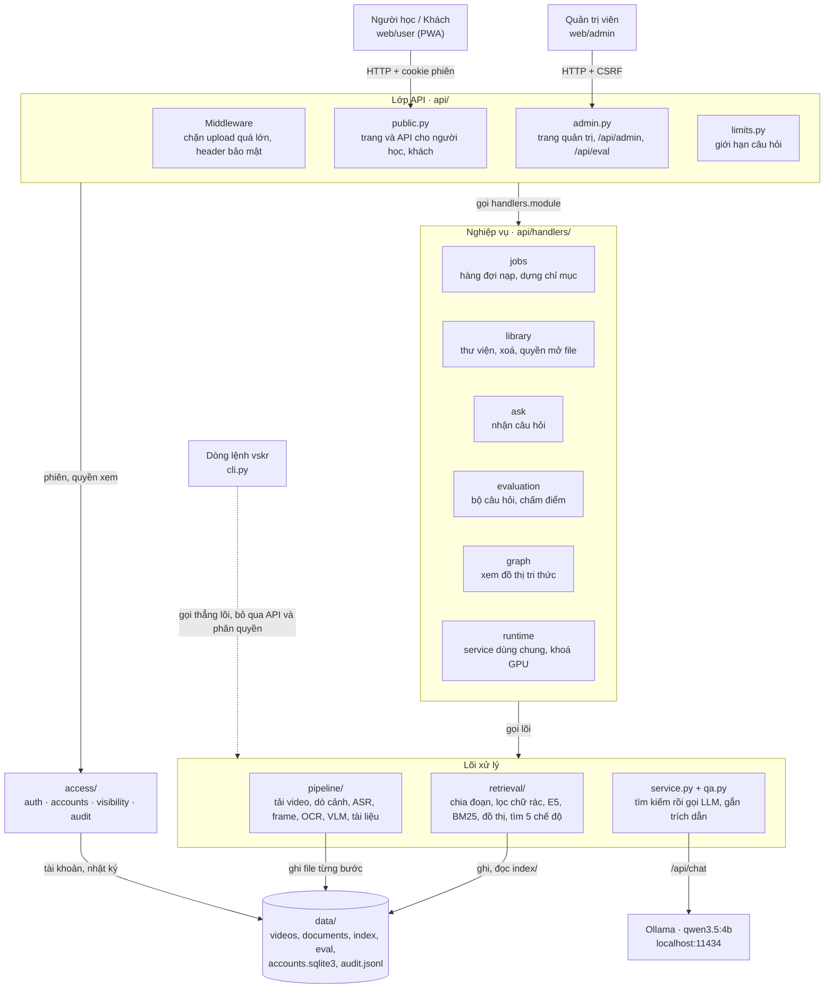
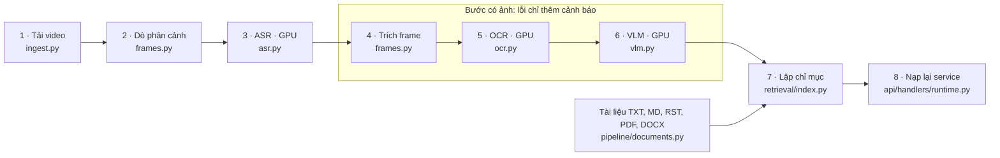
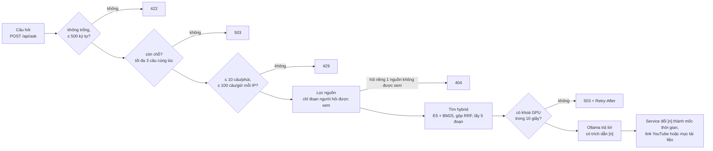
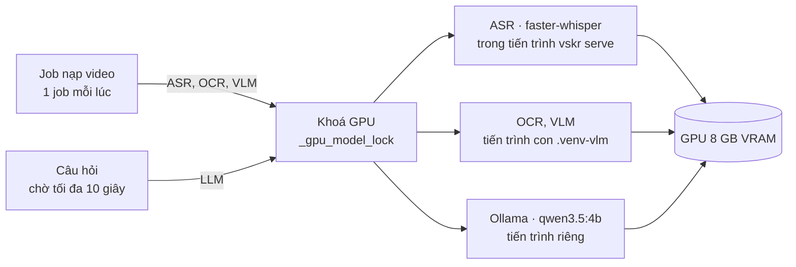
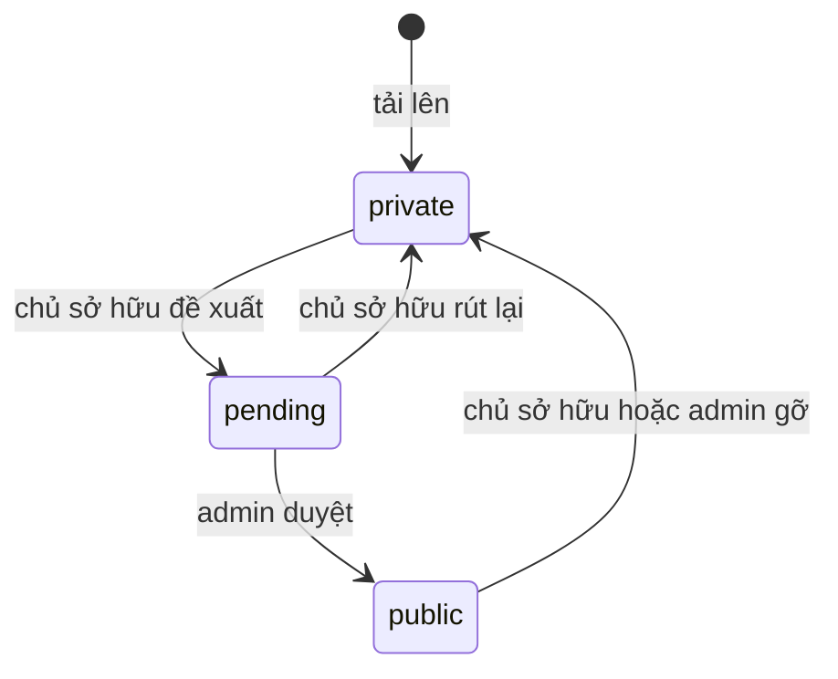

# Kiến trúc VSKR

VSKR biến video bài giảng và tài liệu thành nguồn hỏi đáp tiếng Việt. Mỗi câu trả lời trích dẫn đoạn video (kèm mốc thời gian) hoặc mục tài liệu mà nó dựa vào. Cả hệ thống chạy trên một máy: WSL2, GPU RTX 4060 Laptop 8 GB.

Các hình dưới đây viết bằng Mermaid nên GitHub tự vẽ. Tên module trong hình tính từ `backend/src/vskr/`.

## Các khối chính

- Trình duyệt chỉ gọi lớp API. API hỏi `access/` về phiên và quyền, rồi gọi `api/handlers/`; handlers mới gọi xuống lõi.
- Import trong `api/handlers/` chỉ đi một chiều: `runtime ← jobs ← library` và `runtime ← ask, evaluation, graph`. Trạng thái dùng chung (service, các khoá, danh sách job) chỉ nằm trong `runtime`.
- Server có 66 đường dẫn: 41 trong `public.py`, 25 trong `admin.py`. Quyền của từng đường dẫn ghi ở [ACCESS_MATRIX.md](ACCESS_MATRIX.md).
- Job và phiên admin nằm trong RAM nên mất khi khởi động lại server. Tài khoản, phiên và lịch sử hội thoại của người học nằm trong SQLite.

## Nạp video

`POST /api/ingest` đưa video vào hàng đợi; mỗi lúc chỉ chạy một job. Mỗi bước ghi kết quả ra file, bước sau đọc file của bước trước, nên chạy lại riêng một bước được (`vskr ingest` → `asr` → `frames` → `ocr` → `vlm` → `index`).

| Bước | Công cụ | Ghi ra |
|---|---|---|
| 1 · Tải video | yt-dlp qua `safe_ytdlp`, kiểm tra URL bằng `url_safety` | `data/videos/ID/source.*`, `audio.wav`, `meta.json` |
| 2 · Dò phân cảnh | PySceneDetect | `scenes.json` |
| 3 · ASR | faster-whisper `large-v3-turbo`, mỗi phần 15 phút | `transcript.json`, `.srt`, `.txt` |
| 4 · Trích frame | ffmpeg, chạy song song | `frames/`, `frames.json` |
| 5 · OCR | EasyOCR `vi` + `en`, gộp dòng lặp lại giữa các frame | `screen_text.json`, `ocr_info.json` |
| 6 · VLM | Qwen2.5-VL-3B 4-bit, chỉ mô tả frame ít chữ | `captions.json`, `vlm_info.json` |
| 7 · Lập chỉ mục | chia đoạn, lọc chữ rác OCR, E5, BM25, đồ thị (Ollama trích quan hệ) | `data/index/chunks.json`, `vectors.npy`, `knowledge_graph.json`, `index_info.json` |
| 8 · Nạp lại | service mới thay service cũ | (trong RAM) |

- OCR và VLM chạy trong tiến trình con bằng Python của `.venv-vlm`. Bước 4–6 nếu lỗi thì job chỉ ghi cảnh báo và vẫn lập chỉ mục từ lời giảng.
- Bước 7 bỏ chữ rác OCR (menu, watermark, dãy số dài như mã sinh viên) trước khi chia đoạn; file `screen_text.json` gốc không bị sửa.
- Chỉ mục mới được dựng trong thư mục tạm, xong mới thay thư mục cũ. Câu hỏi đang chạy dùng nốt service cũ; service cũ chỉ đóng khi câu cuối cùng trả lời xong.
- Tài liệu (`POST /api/documents`) được chia mục vào `data/documents/ID/` (`meta.json`, `sections.json`) rồi vào cùng chỉ mục.

## Hỏi đáp

- Ba kiểm tra đầu nằm ở `api/public.py` và `api/limits.py`, các con số lấy từ mục `limits` trong `configs/models.yaml`; lọc nguồn, tìm kiếm và gọi LLM nằm ở `service.py`, `retrieval/retriever.py`, `qa.py`.
- Người học và khách luôn dùng chế độ `hybrid`. Admin hỏi qua `/api/admin/ask` và chọn được cả 5 chế độ.
- LLM chỉ nhận 5 đoạn đã lọc, và prompt không chứa mốc thời gian.
- Khi 5 đoạn vượt `llm.num_ctx`, `qa.build_messages` chia đều chỗ cho từng đoạn và giữ các mẩu chứa từ hiếm của câu hỏi (theo IDF của BM25), chỗ bị lược ghi "…" (`llm.context_packing: extract`). Cách cũ `prefix` cắt đuôi và có thể bỏ hẳn các đoạn cuối.

Vì sao mặc định là `hybrid`: đo ngày 20/11/2026 trên 36 câu hỏi đã duyệt, 3 video, 196 đoạn (chỉ mục có cả chữ OCR và mô tả VLM).

| Chế độ | Cách tìm | Recall@5 | MRR |
|---|---|---:|---:|
| `hybrid` (mặc định) | vector E5 + BM25, gộp thứ hạng bằng RRF | 0.92 | 0.79 |
| `hybrid_graph` | như hybrid, thêm kết quả từ đồ thị tri thức | 0.89 | 0.71 |
| `bm25` | khớp từ khoá | 0.86 | 0.72 |
| `vector` | so nghĩa bằng model nhúng E5 | 0.83 | 0.76 |
| `graph` | chỉ đi theo đồ thị khái niệm | 0.74 | 0.53 |

Recall@5: câu một ý được 1 điểm nếu có đoạn đúng trong 5 kết quả đầu; câu nhiều ý (6/36 câu) được tính theo tỉ lệ ý tìm thấy. MRR càng gần 1 thì đoạn đúng càng đứng đầu.

## GPU và các tiến trình

- GPU 8 GB không chứa nổi cùng lúc model ASR, OCR, VLM và LLM, nên ASR, OCR, VLM và bước LLM của câu hỏi đều phải xin một khoá chung.
- OCR và VLM dùng venv riêng vì cần torch bản CUDA; `.venv` giữ torch bản CPU cho model nhúng E5. E5 chạy CPU nên không cần khoá.
- Trước khi OCR và VLM nạp model, bước đó bảo Ollama nhả model khỏi VRAM (`keep_alive: 0`).
- Ollama chạy riêng bằng `ollama serve`. WSL không có systemd, nên tắt terminal đang chạy Ollama là hỏi đáp sẽ lỗi.

## Quyền xem

`access/visibility.py` (hàm `is_visible`) là quy tắc duy nhất cho thư viện, mở file và tìm kiếm: admin thấy tất cả, `public` ai cũng thấy, còn lại chỉ chủ sở hữu thấy. Chủ sở hữu chỉ đặt được `private` hoặc `pending`; admin đặt được trạng thái bất kỳ.

| Người dùng | Đăng nhập | Lưu ở đâu | Quyền, hạn mức |
|---|---|---|---|
| Admin | tài khoản trong `.env`, mật khẩu băm Argon2id; có CSRF, chặn khi đăng nhập sai nhiều lần | phiên trong RAM | xem và đổi trạng thái mọi học liệu |
| Người học | tự đăng ký (giới hạn số lần theo IP), giữ phiên bằng cookie | `data/accounts.sqlite3`: tài khoản, phiên, hội thoại | video 1 GiB, dài 2 giờ; tài liệu 100 MB; 2 job cùng lúc, 20 job mỗi ngày |
| Khách | không cần tài khoản, nhận diện bằng cookie khách | cookie trên trình duyệt; không lưu lịch sử hội thoại | chỉ tải file lên, chưa được nạp bằng URL; video 100 MB, dài 15 phút; tài liệu 20 MB; 1 job cùng lúc, 3 job mỗi ngày |

Hạn mức lấy từ mục `limits` trong `configs/models.yaml`. Khách chỉ nạp được URL khi bật `ingest.guest_url_ingest_enabled` và đã xác nhận có firewall chặn kết nối ra mạng nội bộ.

## Thư mục

| Đường dẫn | Việc |
|---|---|
| `backend/src/vskr/cli.py` | lệnh `vskr`: ingest, asr, frames, slides, ocr, vlm, index, doc, ask, serve, doctor, admin |
| `backend/src/vskr/config.py`, `util.py` | đọc cấu hình (`models.yaml`, `.env`, biến `VSKR__*`); hàm dùng chung |
| `backend/src/vskr/service.py`, `qa.py` | giữ chỉ mục và bộ tìm kiếm; dựng prompt, gọi Ollama, tách trích dẫn |
| `backend/src/vskr/evaluation.py`, `doctor.py` | chấm Recall@5, MRR; kiểm tra môi trường |
| `backend/src/vskr/pipeline/` | ingest, safe_ytdlp, url_safety, frames, slide_change (thử nghiệm, chạy tay), asr, ocr, vlm, steps, documents |
| `backend/src/vskr/retrieval/` | chunker, screen_filter, embedder, bm25, fusion, knowledge_graph, index, retriever |
| `backend/src/vskr/access/` | auth, accounts, visibility, audit |
| `backend/src/vskr/api/` | app FastAPI và middleware; route trong `public.py`, `admin.py`; `limits.py`; logic trong `handlers/` |
| `backend/requirements/` | thư viện chia nhóm; `core.lock.txt` là phiên bản đã chốt cho `.venv` |
| `web/user/`, `web/admin/`, `web/shared/` | trang người học (PWA), trang quản trị, file dùng chung |
| `configs/models.yaml` | file cấu hình duy nhất |
| `scripts/` | `activate-venv.sh`; `bench/` đo hiệu năng; `eval/` đánh giá truy hồi, câu trả lời và bộ dò trạng thái slide |
| `tests/` | chia thư mục giống backend (`pipeline/`, `retrieval/`, `access/`, `api/`), thêm `web/` và `scripts/`; test chạy xuyên nhiều khâu nằm ở gốc `tests/` |
| `docs/` | tài liệu này; [STATUS.md](./STATUS.md), [DECISIONS.md](./DECISIONS.md), [SECURITY-REVIEW.md](./SECURITY-REVIEW.md), [ACCESS_MATRIX.md](./ACCESS_MATRIX.md), [ROADMAP.md](./ROADMAP.md) (lộ trình nâng cấp, chưa triển khai) |
| `data/`, `cache/` | video, transcript, chỉ mục, tài khoản; model đã tải. Chỉ có trên máy, không đưa lên git |
